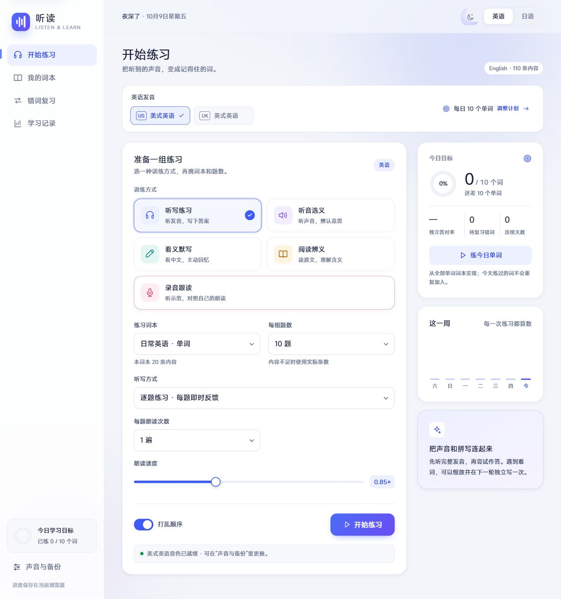
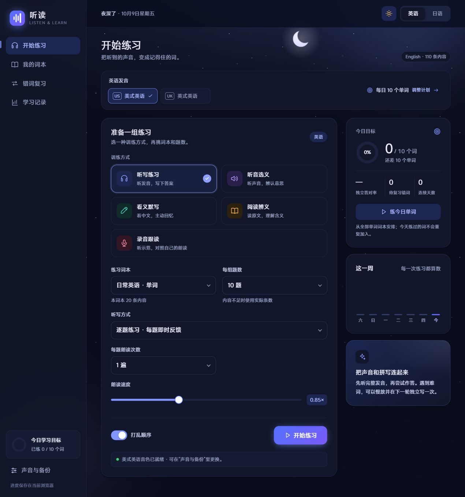
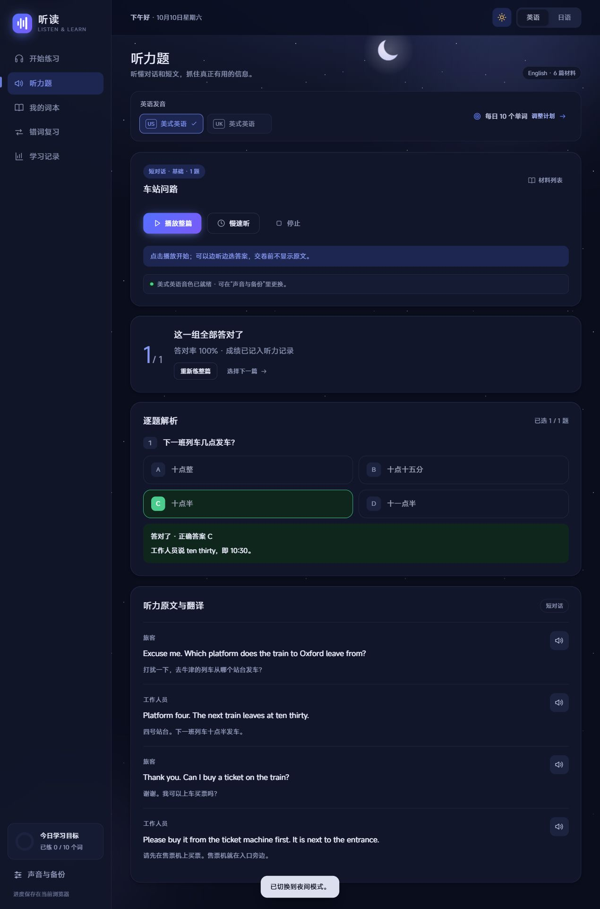
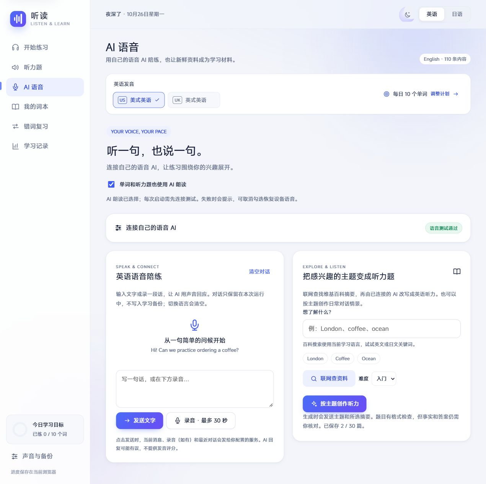

<p align="center">
  
</p>

<h1 align="center">听读 · Tingdu</h1>

<p align="center">每天听一点，读一点。英语与日语单词、短句学习助手。</p>

<p align="center">
  <a href="https://github.com/gothamkismet-cyber/tingdu/releases/latest">下载 Windows / Android 版</a> ·
  <a href="docs/USER_GUIDE.md">使用手册</a> ·
  <a href="docs/BUILDING.md">自己构建</a> ·
  <a href="CHANGELOG.md">更新记录</a>
</p>

<p align="center">
  <a href="LICENSE"></a>
</p>

听读把听写、辨义、默写、跟读、听力理解和错词复习放在一起。无需注册账号，学习记录保存在自己的设备上；可使用内置内容，也能建立自己的词本。2.5 新增自带 API 的英日语音陪练、AI 朗读，以及联网资料生成听力。提供 Windows 便携版、Android 应用和本机浏览器版。

## 界面预览

| 白天 | 夜间 |
| --- | --- |
|  |  |

四种配色、定时夜间、星空背景和可选开场动画；默认直接进入，支持窄屏导航、键盘操作及系统的“减少动态效果”设置。





AI 页展示连接后的状态；截图使用本机模拟接口，实际声音与回答由你接入的服务提供。

## 可以做什么

| 功能 | 说明 |
| --- | --- |
| 五种训练 | 听写、听音选义、看义默写、阅读辨义、录音跟读 |
| 听力题 | 英语、日语各 6 篇短对话 / 短文，共 36 道选择题；交卷看原文、翻译和解析，支持错题重练 |
| AI 语音陪练 | 自填 OpenAI 兼容音频 API；支持文字、录音提问和语音回复，收到有效 WAV 才启用 |
| 联网生成听力 | 搜索英日维基百科摘要，生成带来源的听力题；也可按主题创作，最多保存 30 篇 |
| 美式 / 英式英语 | 选择设备上的 `en-US` 或 `en-GB` 音色；没有对应音色时明确提示 |
| 每日单词计划 | 首次打开设置目标；英语、日语分别设置每天 1–100 个单词 |
| 今日练习 | 按剩余目标安排单词，同一天同一个单词只计一次 |
| 整组听写 | 先听完并填写，再统一判分；可设置朗读次数和题间停顿 |
| 自建词本 | 批量录入、编辑和归档；保留已有答题记录 |
| 错词与到期复习 | 按语言、训练方式和答案要求重练 |
| 保存与迁移 | 自动保存进度，导出 / 恢复 JSON 备份，继续未完成练习 |

内置 **英语 80 个单词、30 条短句，日语 20 个单词、10 条短句**，共 140 条内容，涵盖基础、旅行、餐饮购物、学习工作等场景。录音跟读用于自行比较，不提供自动发音评分。

## 下载与使用

前往 **[最新发布](https://github.com/gothamkismet-cyber/tingdu/releases/latest)**：

| 文件 | 用途 |
| --- | --- |
| `tingdu-2.5.0-windows-x64.zip` | Windows x64 文件夹便携版，完整解压后运行 `听读.exe`，无需 Node.js |
| `tingdu-2.5.0-android.apk` | Android 7.0 及以上，下载后安装 |
| `SHA256SUMS.txt` | 两个下载文件的 SHA-256 校验值 |

Windows 请先把 ZIP **完整解压到一个文件夹**，以后双击里面的 `听读.exe`；可以给它创建桌面快捷方式，不能单独移走 exe。这样免去旧单文件版每次启动都解压运行环境的等待。升级继续使用 `%APPDATA%\Tingdu` 中的学习记录。

首次打开先设置每日目标与英语口音，再到“声音与备份”试听。默认快速进入，喜欢原开场的用户可在外观设置中开启“完整开场动画”。Windows 文件目前没有代码签名；APK 使用项目发布密钥签名。Android 包已做构建、签名与资源检查，**尚未在真机或模拟器上验证**。

默认朗读依赖设备或浏览器提供的音色，也可自行接入语音 AI。缺少英式英语、日语等音色时，需要安装相应系统语音数据；仍可使用看义默写、阅读辨义和词本。内置英语音标标注为美式音标，切换口音不会改写词条或判题答案。

AI 用户先打开「AI 语音」，填写根地址、密钥、音频模型和音色，再点「保存并测试语音」。默认示例模型为 `gpt-audio-1.5`，纯文本模型不适用；调用可能产生服务商费用。详细协议、操作和数据去向见 [AI 语音与联网说明](docs/AI_VOICE.md)。

具体练习、词本格式和备份方法见 [使用手册](docs/USER_GUIDE.md)。

## 从源码运行

需要 **Node.js 22.12 或更新版本**，联网使用建议采用 Node.js 24 LTS 的最新安全补丁版。浏览器版运行只使用 Node 内置模块：

```sh
git clone https://github.com/gothamkismet-cyber/tingdu.git
cd tingdu
npm start
```

打开 [http://127.0.0.1:4173/](http://127.0.0.1:4173/)。Windows 也可双击 `启动听读.cmd`。如果 PowerShell 拦截 `npm.ps1`，使用 `npm.cmd`。服务只监听本机，不对局域网开放；请通过服务访问页面，不要直接打开 HTML 文件。

开发检查：

```sh
npm ci --ignore-scripts
npm test
npm run check
```

`--ignore-scripts` 跳过 Electron 运行环境下载，足够运行网页和自动检查。桌面与 Android 打包步骤见 [构建说明](docs/BUILDING.md)。

## 数据与声音

- 没有账号服务、自动云同步或应用内遥测。Windows、Android 和不同浏览器分别保存数据，通过 JSON 备份迁移。
- 备份包含词本、进度、未完成练习、最近 5000 条单词 / 短句作答，以及英日听力草稿、最近 100 组听力成绩和最多 30 篇自建听力；录音、AI 对话与密钥不进入备份。
- 原录音跟读留在本机。AI 陪练录音先预听，只有点击发送才上传到你配置的服务；消息、朗读和听力生成也会发送对应内容。百科搜索不发送 API 密钥。
- API 密钥独立管理：Windows / Android 可选择系统加密保存，浏览器仅本次运行持有。启动不自动调用 AI，每次使用前手动测试。
- 在线系统音色可能通过其语音提供方处理朗读文本；是否离线取决于设备与所选音色。
- 卸载 Android 应用或清除浏览器站点数据会删除本地记录，请先导出备份。

## 项目结构

```text
web/dist/       可直接编辑的 HTML、CSS、JavaScript 源码
web/            本机服务与 Windows 语音接口
desktop/        Electron 桌面窗口、存储和权限处理
android/        原生 Android WebView 承载
scripts/        源码检查、音频检查、图标与 APK 构建
tests/          学习逻辑、保存、声音、主题和升级测试
docs/           使用、构建说明与界面截图
```

当前有 66 项自动化测试，覆盖学习、存储、AI 接口、取消、音频能力验证和生成听力。仓库附有 Windows / Linux 的 [GitHub Actions 检查模板](docs/ci.yml)，启用方法见构建说明。自动检查不能代替实际麦克风、音质、系统音色和 Android 真机体验；这些边界也记录在发布说明中。

欢迎通过 [Issues](https://github.com/gothamkismet-cyber/tingdu/issues) 反馈，或按 [贡献指南](CONTRIBUTING.md) 提交改进。

## 许可证

项目源码采用 [MIT 许可证](LICENSE)。由百科摘要改编的自建听力另标注 CC BY-SA 4.0 来源和许可。第三方运行环境与开发工具遵循各自许可，见 [第三方声明](THIRD_PARTY_NOTICES.md)。
